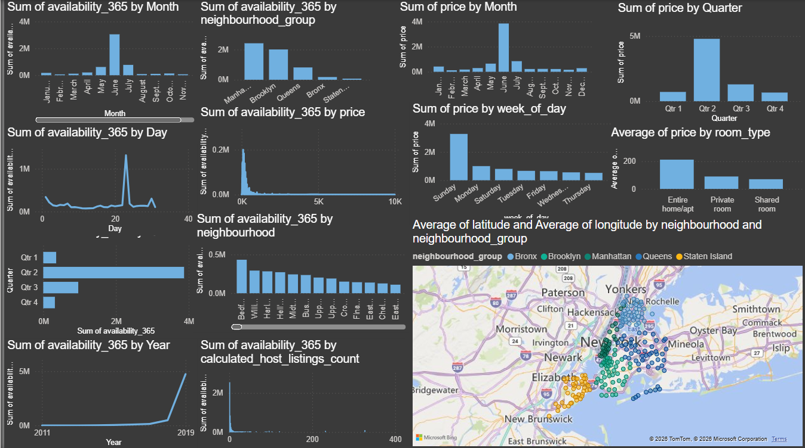
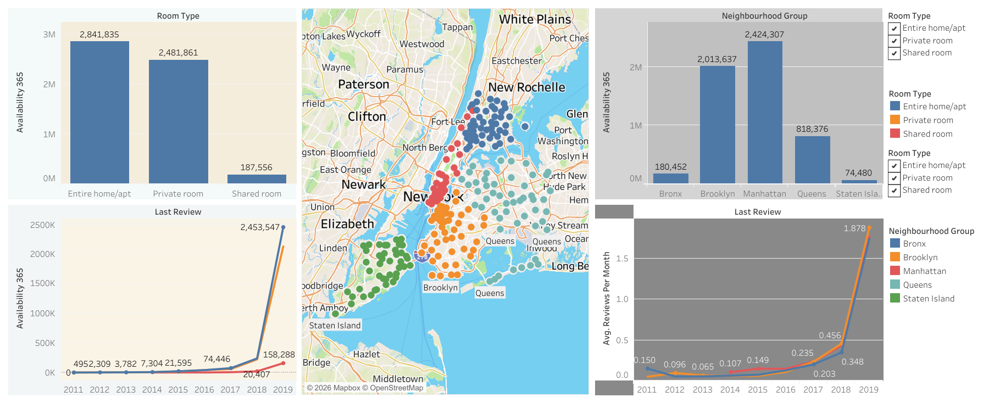

# Airbnb Bookings Analysis | Python, Power BI & Tableau

An end-to-end data analytics project exploring Airbnb listings in New York City through exploratory data analysis, statistical relationships, data visualization, and business intelligence dashboards.

The project uses Python to investigate listing prices, room types, neighbourhoods, availability, and guest reviews, with Excel-based analysis and interactive dashboard files in Power BI and Tableau.

## Project Overview

| Project Detail | Description |
|---|---|
| Project Name | Airbnb Bookings Analysis |
| Domain | Travel, Hospitality & Property Analytics |
| Project Type | Exploratory Data Analysis (EDA) |
| Contribution | Individual |
| Primary Language | Python |
| BI Tools | Microsoft Power BI, Tableau |
| Supporting Tools | Excel, Jupyter Notebook |
| Dataset | Airbnb NYC 2019 |

## Business Problem

Airbnb listings vary in price, accommodation type, location, availability, and customer feedback. Understanding these factors can help hosts improve listing performance and help business stakeholders identify patterns in accommodation supply and customer preferences.

This project explores the available listing data to identify meaningful patterns, compare property segments, understand location-based pricing differences, and translate exploratory findings into actionable business questions.

### Business Objectives

- Identify neighbourhood groups and neighbourhoods with substantial listing representation.
- Compare listing prices across room types and geographical areas.
- Analyse the distribution of entire homes/apartments, private rooms, and shared rooms.
- Investigate listing availability across the year.
- Examine relationships between price, reviews, minimum nights, and availability.
- Understand review patterns as an indicator of guest engagement.
- Present analytical findings through Python visualizations and BI dashboards.
- Develop evidence-based recommendations for hosts and hospitality stakeholders.

## Dataset Overview

**Primary dataset:** `Airbnb NYC 2019.csv`

The repository also contains revised CSV and Excel datasets and an Excel pivot analysis workbook.

The original notebook uses listing-level data with fields including:

| Field | Description |
|---|---|
| `id` | Unique listing identifier |
| `name` | Listing name |
| `host_id` | Host identifier |
| `host_name` | Host name |
| `neighbourhood_group` | Broad geographical area |
| `neighbourhood` | Neighbourhood associated with a listing |
| `latitude`, `longitude` | Geographic coordinates |
| `room_type` | Type of accommodation |
| `price` | Listed nightly price |
| `minimum_nights` | Minimum required stay |
| `number_of_reviews` | Total reviews recorded |
| `last_review` | Date of the most recent review |
| `reviews_per_month` | Average monthly review frequency |
| `calculated_host_listings_count` | Number of listings associated with a host |
| `availability_365` | Number of days available during the year |

The dataset represents listing information rather than a complete transaction-level booking history. Therefore, listing price and availability should not be interpreted as actual revenue or confirmed occupancy without additional booking and transaction data.

## Analytical Workflow

1. **Data loading** — Import the Airbnb dataset using Pandas.
2. **Data inspection** — Review columns, data types, records, and summary statistics.
3. **Data quality assessment** — Investigate missing values, duplicates, inconsistent data types, and potential outliers.
4. **Data preparation** — Apply appropriate cleaning and transformations where required.
5. **Exploratory analysis** — Examine individual variables and relationships between variables.
6. **Statistical analysis** — Use aggregation, grouping, and correlation to explore patterns.
7. **Data visualization** — Communicate findings through charts and comparative plots.
8. **Business intelligence** — Explore the available Power BI and Tableau dashboard files.
9. **Recommendations** — Translate supported observations into practical business implications.

## Python Exploratory Data Analysis

The notebook uses Python libraries and visualization techniques to explore the dataset.

### Analysis Areas

**1. Geographical analysis**
- Listing distribution by neighbourhood group.
- Neighbourhood-level comparisons.
- Geographic coordinates for location-based exploration.

**2. Pricing analysis**
- Distribution of listing prices.
- Average prices across room types.
- Price comparisons across neighbourhoods.
- Investigation of unusually high or low price values.

**3. Accommodation analysis**
- Listing counts by room type.
- Price comparisons between entire homes, private rooms, and shared rooms.
- Relationships between accommodation type and minimum-night requirements.

**4. Availability analysis**
- Comparison of listings by annual availability.
- Investigation of availability in relation to room type, price, and reviews.
- Identification of patterns that may warrant further demand analysis.

**5. Guest review analysis**
- Distribution of review counts.
- Monthly review frequency.
- Relationships between reviews, listing prices, and availability.

**6. Statistical relationships**
- Grouped summaries and aggregations.
- Correlation analysis.
- Pair plots and heatmaps to investigate relationships among selected variables.

### Visualization Methods

The notebook uses methods including:

- Count plots
- Bar plots
- Line plots
- Pair plots
- Correlation heatmaps
- Grouped aggregations
- Comparative and distribution analysis

Charts should be interpreted alongside their underlying sample sizes, data quality, and limitations. Correlation alone does not establish causation.

## Power BI Dashboard

**Dashboard file:** [`AirBnb_BI.pbix`](./AirBnb_BI.pbix)

The Power BI file is included in this repository for interactive exploration.

### Dashboard Preview



*Add a screenshot of your actual Power BI dashboard to the path shown above.*

### Suggested dashboard exploration

Depending on the visuals and measures included in the existing report, explore:

- Listing distribution across neighbourhood groups.
- Price comparisons across locations and room types.
- Accommodation-type composition.
- Availability and review patterns.
- Interactive filtering and comparative analysis.

Open the `.pbix` file in Power BI Desktop to inspect the actual report pages, measures, and filters.

## Tableau Dashboard

**Packaged workbook:** [`AirBnb_Cap_4.twbx`](./AirBnb_Cap_4.twbx)

The Tableau packaged workbook is available for dashboard exploration and visual analysis.

### Dashboard Preview



*Add a screenshot of your actual Tableau dashboard to the path shown above.*

### Suggested dashboard exploration

Use the existing Tableau worksheets and dashboard pages to investigate:

- Geographic variation in listing characteristics.
- Room-type and price comparisons.
- Neighbourhood-level patterns.
- Relationships between selected listing metrics.

The final description of each dashboard should match the visualizations and calculations present in the workbook.

## Excel Analysis

The repository includes Excel-based analysis files:

- [`AirBnb_Revised-Pivots.xlsx`](./AirBnb_Revised-Pivots.xlsx) — pivot-based analysis.
- [`AirBnb_Revised.xlsx`](./AirBnb_Revised.xlsx) — revised spreadsheet dataset.
- [`AirBnb_Revised.csv`](./AirBnb_Revised.csv) — revised CSV dataset.

These files support spreadsheet-based inspection, aggregation, and comparison alongside the Python and BI workflows.

## Key Business Questions

The project is designed to investigate questions such as:

1. Which neighbourhood groups contain the most listings?
2. How do prices differ across accommodation types?
3. Which locations have higher average listing prices?
4. How is listing availability distributed?
5. Do review counts and monthly review frequency vary across room types?
6. What relationships exist between price, minimum nights, reviews, and availability?
7. How can hosts use listing-level patterns to improve pricing and availability decisions?

Specific conclusions should be reported from the executed notebook and actual dashboard results rather than assumed in advance.

## Business Applications

| Analytical Finding | Potential Business Application |
|---|---|
| Geographic price differences | Support location-aware pricing research |
| Room-type differences | Understand accommodation preferences |
| Availability patterns | Identify listings for further demand investigation |
| Review distributions | Examine customer engagement and listing visibility |
| Unusual price values | Improve data validation and pricing analysis |
| Relationships between listing features | Guide further statistical investigation |

These are potential applications of the analysis, not claims of measured financial impact.

## Technology Stack

| Category | Technologies |
|---|---|
| Programming | Python |
| Data manipulation | Pandas, NumPy |
| Data visualization | Matplotlib, Seaborn |
| Development environment | Jupyter Notebook / Google Colab |
| Business intelligence | Microsoft Power BI, Tableau |
| Spreadsheet analysis | Microsoft Excel |
| Analytical methods | EDA, aggregation, grouping, correlation, comparative analysis |

## Repository Structure

```text
AirBnb_Bookings_Analysis/
│
├── AirBnb_Bookings_Analysis.ipynb
├── AirBnb_BI.pbix
├── AirBnb_Cap_4.twbx
├── AirBnb_Revised-Pivots.xlsx
├── AirBnb_Revised.csv
├── AirBnb_Revised.xlsx
├── Airbnb NYC 2019.csv
├── assets/
│   ├── powerbi-dashboard.png
│   └── tableau-dashboard.png
└── README.md
```

The `assets/` directory is a proposed addition for dashboard screenshots.

## Getting Started

### Prerequisites

- Python 3.9 or later
- Jupyter Notebook or Google Colab
- Microsoft Power BI Desktop to open the `.pbix` file
- Tableau Desktop or a compatible Tableau application to open the `.twbx` file

### 1. Clone the repository

```bash
git clone https://github.com/sm292/AirBnb_Bookings_Analysis.git
cd AirBnb_Bookings_Analysis
```

### 2. Create a virtual environment

```bash
python -m venv .venv
```

Activate it on Windows:

```bash
.venv\Scripts\activate
```

On macOS or Linux:

```bash
source .venv/bin/activate
```

### 3. Install Python libraries

```bash
pip install pandas numpy matplotlib seaborn jupyter
```

### 4. Run the notebook

```bash
jupyter notebook AirBnb_Bookings_Analysis.ipynb
```

Ensure that the notebook reads the dataset from your local project directory. The original notebook uses a Google Drive path, so update the dataset-loading cell when running locally.

### 5. Open the BI dashboards

- Power BI: open `AirBnb_BI.pbix`.
- Tableau: open `AirBnb_Cap_4.twbx`.
- Excel: open the relevant revised dataset or pivot workbook.

If a dashboard requires a data source path update, reconnect it to the appropriate local dataset before refreshing.

## Skills Demonstrated

- Exploratory Data Analysis (EDA)
- Data cleaning and quality inspection
- Python data manipulation with Pandas and NumPy
- Statistical summaries and correlation analysis
- Data visualization with Matplotlib and Seaborn
- Geographic and categorical analysis
- Pricing and availability analysis
- Microsoft Power BI
- Tableau dashboard exploration
- Microsoft Excel and pivot-based analysis
- Business problem framing
- Analytical storytelling and insight communication

## Limitations and Future Improvements

- Add reproducible local data paths and a dependency file.
- Document cleaning decisions and missing-value treatment.
- Add verified KPI definitions and measured findings.
- Include dashboard screenshots and detailed chart explanations.
- Add automated data-quality checks.
- Investigate demand using booking-level data where available.
- Evaluate price relationships with suitable statistical methods.
- Improve reproducibility by documenting data sources and refresh requirements.

## Author

**Sumit Mondal**

- GitHub: [@sm292](https://github.com/sm292)
- Project Repository: [AirBnb_Bookings_Analysis](https://github.com/sm292/AirBnb_Bookings_Analysis)
- LinkedIn: [Sumit Mondal](https://www.linkedin.com/in/sumit-mondal-6a07b0174/)

---

*This project demonstrates practical data analytics skills through exploratory analysis, statistical investigation, visualization, and business intelligence reporting.*
